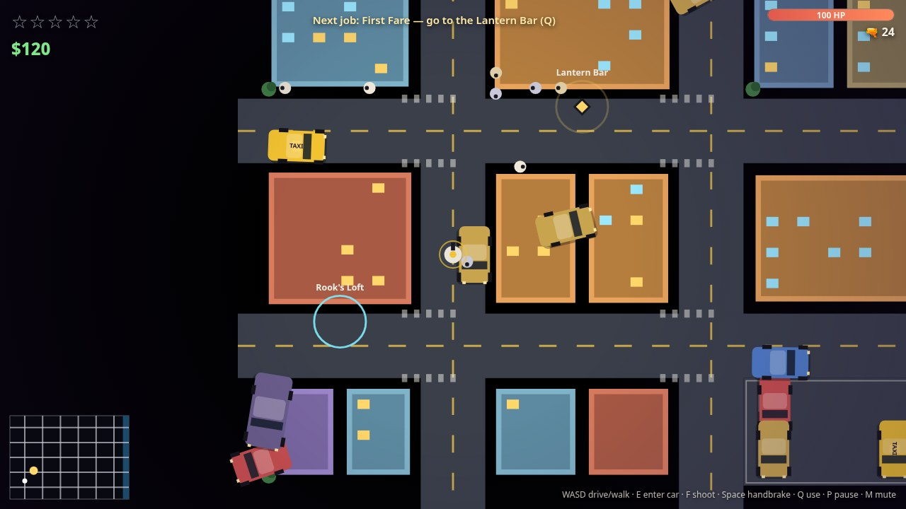

# NEONHARBOR — an open-world crime game

[](https://make.fun/bounty/gta6-01?utm_source=github&utm_medium=readme&utm_campaign=gta6-01)
[](https://make.fun/bounty/gta6-01/leaderboard?utm_source=github&utm_medium=readme&utm_campaign=gta6-01)
[](https://make.fun/bounty/gta6-01?utm_source=github&utm_medium=readme&utm_campaign=gta6-01)

Entered on [make.fun](https://make.fun/?utm_source=github&utm_medium=readme&utm_campaign=gta6-01) — see the [gta6-01 bounty](https://make.fun/bounty/gta6-01).



**NEONHARBOR** is an original top-down 2D open-world crime game in the spirit
of GTA 1/2, built for the make.fun bounty **gta6-01** ("Make GTA 6", $1,666).
You are **Rook**, a driver-for-hire in Neon Harbor, a coastal neon city. Take
jobs from the harbor fixers at the Lantern Bar, steal cars, outrun the Harbor
PD, and climb the underworld — or just cruise the city, run taxi fares, and
sell hot cars at the Chop Shop.

Everything is original: our own city, characters, vehicles, names, story, art
and sound. No Rockstar names, logos, characters, maps or assets anywhere.
All art and sound are generated in code; the game loads no assets and makes
no network requests.

## How to play

Serve the game with any static file server and open `game/index.html` in
desktop Chrome:

```sh
node serve.ts        # serves game/ at http://localhost:8080
```

Or open `game/index.html` directly from disk — it runs offline from static
files.

### Controls

| Key | Action |
| --- | --- |
| WASD / arrows | Walk / drive (up = accelerate, down = brake/reverse) |
| E | Enter / exit a car (steal parked cars, or pull the driver out) |
| Space | Handbrake |
| F or mouse click | Shoot the pistol (aims at the mouse) / punch when out of ammo |
| Q | Use a place (take a job, repair, heal, buy ammo, sell a car, save) |
| P | Pause |
| M | Mute |
| R | Restart the run from your last save |

Touch: drag anywhere to move (virtual stick).

### The city

Neon Harbor is a 2560×1792 grid city with six avenues, five streets, a marina
and a beach on the east edge. Landmarks:

- **Lantern Bar** — take story jobs here (Q)
- **Rook's Loft** — safehouse: clears your wanted level and saves the game
- **Pit Stop Garage** — repair your car ($80)
- **Med Stop** — heal up ($60)
- **Harbor Arms** — buy pistol ammo ($40 for 12 rounds)
- **Chop Shop** — sell a car, no questions asked ($150, $300 for the Sunray)
- **Harbor Bank** — the scene of the final job
- **Taxi Depot / Marina** — fares and drop-offs

### Story — six jobs

1. **First Fare** (Mara, $150) — pick up a fare at the bar, drop them at the Marina.
2. **Hot Wheels** (Deke, $300) — steal the yellow Sunray from the north lot, deliver it to the Chop Shop.
3. **The Tail** (Mara, $400) — follow the grey sedan for 45 seconds without being spotted.
4. **Getaway** (Deke, $350) — lose a 3-star wanted level, then reach the Loft.
5. **The Drop** (Iris, $450) — a parcel to the Marina in 60 seconds, starting at 2 stars.
6. **Harbor Heist** (Mara, $1,200) — hold the bank vault for 6 seconds past the armed guards, lose the heat, reach the Loft. Finish all six and the harbor is yours.

Plus repeatable **taxi fares** while you drive.

### Wanted system

Crime adds heat: stealing a car, running over a pedestrian, shooting, killing
a cop. Heat is 1–5 stars. Foot cops chase and arrest you (stand on you for
~1.2 s and you are BUSTED); police cars chase and ram. Heat decays when no
cop can see you; the Loft clears it at once. Getting arrested costs $100 bail.
Dying sends you to the WASTED screen — retry from your last save.

## How it is built

Vanilla ES modules on one `<canvas>`, zero libraries, zero assets, zero
network requests. All art is drawn in code; all sound is WebAudio synth
(engine hum, sirens, shots, pickups) plus a generative dusk-drive music loop.

```
game/index.html        one canvas + HUD + screens
game/src/config.js     tuning, city layout, car types, missions, economy
game/src/city.js       the city: roads, blocks, buildings, zones, collisions
game/src/world.js      the simulation: update loop, stealing, zones, saves
game/src/vehicles.js   car physics, damage, enter/exit, car-car collisions
game/src/player.js     Rook on foot: movement, health, cash, ammo
game/src/traffic.js    NPC cars: lanes, intersections, car-ahead braking
game/src/pedestrians.js  sidewalk walkers who flee danger
game/src/police.js     wanted heat/stars, foot cops, police-car chases
game/src/combat.js     pistol bullets, melee, armed bank guards
game/src/missions.js   the 6-story arc + taxi side jobs
game/src/particles.js  bursts, smoke, skid marks, floating text
game/src/render.js     all canvas drawing + minimap + dusk lighting
game/src/ui.js         DOM HUD, banners, title/pause/wasted/busted/victory
game/src/audio.js      WebAudio synth SFX + generative music
game/src/input.js      keyboard, mouse, touch
game/src/save.js       localStorage save / continue / best score
game/src/shots.js      screenshot staging (?shot=1-start|2-drive|3-chase|4-mission)
game/src/main.js       boot, frame loop, screen wiring, ?debug=1 helpers
```

## Building the entry

```sh
mkdir -p out && MAKEFUN_OUTPUT_DIR=out node main.ts   # writes out/ (game + screenshots + dossier.json)
```

`main.ts` copies `game/` and `screenshots/` to the output directory and
writes `dossier.json` with the vendored make.fun library
(`vendor/makefun-game.ts`, unchanged from the kit).

## Testing

```sh
node tests/logic.mjs            # headless Node logic test: 36 checks
bash tests/chrome.sh 9227       # test browser (leave running)
node tests/bundle.mjs           # builds tests/bundle.html (file:// test copy)
CDP_PORT=9227 node tests/shots-cdp.mjs      # 4 real screenshots -> screenshots/
CDP_PORT=9227 node tests/playtest-cdp.mjs   # full interactive playtest in real Chrome
```

Final re-verification (2026-11-17 ~22:50 WIB, in the sealed re-recorded
session): logic **36/36**, browser playtest **26/26** (zero console errors,
zero failed requests, zero http requests), screenshots **SHOTS OK** (4×
1280×720), `main.ts` build exit 0 with `out/` identical to `game/` +
`screenshots/`, `node serve.ts` answers 200 for index and main.js. See
`BUILD-REPORT.md` for the full results, the bugs found and fixed, and what
is not yet verified.

## Debug

`game/index.html?debug=1` exposes `window.__NEONHARBOR__` with `setWanted(n)`,
`setMission(i)`, `teleport(x, y)`, `giveCash(n)` and `addHeat(n)` — test
helpers only, kept out of the normal flow.
